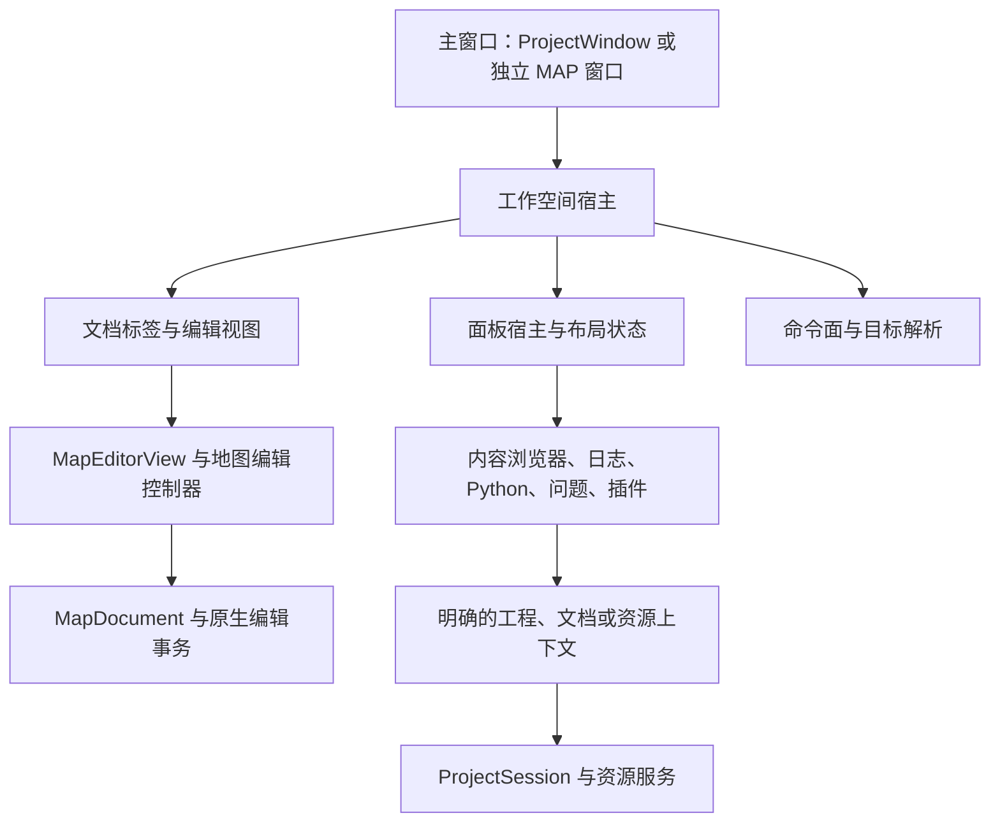

# 工作空间与面板体系设计

日期：2026-10-30。代码核对基线：`d1e4e5ee5`。

本文是工作空间 UI 架构改造的实施设计。第一批面板宿主与所有权已落实；
其余目标接口与阶段仍是后续设计，不能视为已经完成。
工程存储、资源捕获和发布语义继续以
[工程工作区实施交接](project-workspace-implementation.md) 为准；
工作空间 UI 的职责、布局和迁移顺序以本文为准。
控件外观继续遵守 [UI 组件样式治理](ui-component-style-governance.md)。

## 1. 改造目标

一个主窗口提供一个工作空间。打开工程时承载多张地图和工程内容；直接打开 MAP 时
使用同一套界面基础设施，保留普通 MAP 的保存与关闭规则。

用户应当能够判断三件事：正在编辑哪张地图、当前面板显示谁的内容、下一条操作会作用于谁。
新增资源编辑器或插件工具时，应接入已有面板、命令和生命周期机制。

继续使用 Qt Widgets 和现有 OpenGL 视口。已有主题、标准控件、地图事务、资源存储和
编译快照继续使用各自的原生实现。本轮首先解决工作空间组织和行为归属。

## 2. 基线问题与第一批进展

| 位置 | 基线事实 | 处理进展或后续问题 |
| --- | --- | --- |
| `ProjectWindow` | 通过 `QStackedWidget` 嵌入完整 `MapWindow`，隐藏子窗口菜单与工具栏 | 工程页仍携带完整窗口的命令和关闭职责 |
| `MapEditorView::takeInfoPanel` | 把信息面板交给工程展示，析构时仍手动删除它 | 第一批已移除此接口；工程宿主登记并拥有面板，地图窗口在文档和 GL 上下文释放前通知宿主销毁面板 |
| `ProjectToolPanel` | 同时管理工具选择、覆盖布局、固定布局、焦点与设置；通过整数偏移映射 `InfoPanelPage` | 第一批使用 `ProjectToolId` 和显式页面映射；插件工具登记留到第四批 |
| `MapEditorView::isInfoPanelVisible` | 外部托管时查询信息面板自身的可见性 | 第一批由宿主发布区域展开状态；工具显示状态通过 `isToolVisible` 单独查询，菜单和底栏随同一状态更新 |
| `ActionExecutionContext` | 保存 `MapWindow*` 与 `MapViewBase*` | 编辑命令依赖窗口对象；面板移动后容易再次依赖父控件查找 |
| `WidgetState` | 设置键为 `Windows/<objectName>/<suffix>` | 控件发现名称承担持久化身份；工程和独立 MAP 的布局容易互相影响 |
| `ProjectAssetPanel` | 为无活动地图时的浏览创建后备 `MapDocument` | 资源浏览与地图服务耦合，后续预览服务需要明确资源上下文 |

底部重复面板已经在基线提交中合并，抽屉与固定停靠也已可用。这提供了交互起点，
接下来需要把实现中的所有权、可见性和上下文边界收拢。

## 3. 界面区域与状态归属

| 区域 | 用户看到的内容 | 状态归属 |
| --- | --- | --- |
| 顶部命令区 | 菜单、常用工具、命令搜索 | 工作空间创建一份命令面；动作按其作用域解析目标 |
| 文档标签区 | 地图标签，后续可接入资源编辑标签 | 工作空间管理标签；会话管理文档数据 |
| 中央编辑区 | 当前文档的视口和编辑工具 | 对应文档与视图实例 |
| 右侧检查区 | 地图、实体、面、层级、插件检查器 | 绑定明确的活动文档或资源；标题显示目标 |
| 底部工具区 | 内容浏览器、输出日志、Python、问题 | 宿主管布局；各工具拥有自己的内容和绑定状态 |
| 底部状态区 | 活动地图、网格、对齐、任务与诊断摘要 | 工作空间展示，数据由当前文档和任务服务提供 |

底部工具入口与状态信息最终组成一条底栏。展开工具时只出现一个工具区域，支持临时
覆盖和固定占位。右侧检查器继续承担上下文检查，插件入口打开插件声明的目标区域。
目前“扩展”仍打开原有右侧插件检查器；后续工具注册必须说明其区域和上下文要求。

## 4. 对象与依赖方向

以下为职责名称，实施时优先扩展已有拥有者；不要求为每一行新增一个类。

- `ProjectSession` 继续负责工程内容、保留的地图文档、保存、历史和资源事务。
- 工作空间宿主负责当前标签、面板区域、命令面和窗口关闭协调，不实现资源转换或地图编辑。
- 地图编辑控制器从 `MapWindow` 提取地图操作和对话框协调，供独立窗口和工程页共同使用。
- `MapEditorView` 负责视口、布局及输入转发，借用文档；关闭视图仍可保留工程文档。
- 面板宿主拥有其 QWidget 树，负责展示与销毁。面板持有带失效通知的上下文绑定；
  会话关闭必须先断开任务和绑定、销毁相关面板，再释放文档与渲染依赖。
- 底层编辑与资源服务不通过 QWidget 父链寻找窗口或命令目标。

## 5. 面板契约

在现有 `ProjectToolPanel` 上分离“工具内容”与“区域展示”，再让独立 MAP 使用同一宿主。
第一步覆盖现有内置工具，接口稳定后再接入插件声明。

每个工具描述至少包含稳定 ID、标题、目标区域、实例作用域、所需能力和内容工厂。
内置工具使用类型化 ID；插件使用带插件命名空间的 ID。标签文本和枚举序号不作为身份。

实例作用域必须明确：

| 工具 | 实例与数据策略 |
| --- | --- |
| 内容浏览器 | 每个工作空间一份，保留来源、搜索、资源选择和详情；可以没有活动地图 |
| 输出日志 | 保留当前的每地图日志流，切换地图切换显示；工程任务按所属工程记录 |
| Python 控制台 | 第一批保留每地图输入、历史和输出；执行时捕获该次文档目标 |
| 问题 | 显示当前文档的诊断；异步结果校验文档身份与代次 |
| 插件工具 | 由描述声明工作空间级或文档级实例，明确文档关闭与插件卸载的清理行为 |

宿主只提供注册、显示、收起、固定、选择和解绑等窄接口。工具间切换使用工具 ID，
不再以 `static_cast<int>(InfoPanelPage) + 1` 推导索引。
“区域展开”“当前工具”“当前工具绑定的文档”分别建模；显示浏览器时，底部区域
仍是展开状态。工具内容隐藏不代表区域关闭。

文档级内容通过宿主持有的受控实例登记，视图结束时显式注销；宿主解绑对应面板后
再释放它使用的文档服务。宿主与视图之间不再使用交出 QWidget 后由原视图手动删除的约定。
文档保留不等于必须保留全部工具 QWidget，工具数据与控件生命周期应可分离。

## 6. 命令目标与焦点

复用现有 `MapCommandSurface` 的上下文工厂，逐步让命令接收所需能力，减少
`MapWindow*` 依赖。需要视口的命令必须声明视口要求；资源导出等命令可以没有地图。
一次执行中固定目标；异步工作还要校验目标代次和资源修订。

| 作用域 | 示例 | 目标规则 |
| --- | --- | --- |
| 应用 | 首选项、打开文件 | 应用服务 |
| 工作空间 | 保存工程、关联库 | 发起操作的工作空间 |
| 文档 | 分组、地图撤销、运行编译 | 当前明确激活的地图标签，或调用方提供的显式目标 |
| 资源 | 重导入、导出副本、查看引用 | 资源选择中的来源、稳定 ID 和修订 |
| 编辑控件 | 搜索框撤销、文本复制粘贴 | 获得焦点的原生控件 |

点击浏览器、搜索框或日志不改变活动地图。点击地图标签或明确激活地图才改变它。
快捷键先尊重文本控件、弹出菜单和模态对话框，再解析编辑器命令。
无目标时禁用相应入口并给出原因，执行时再次校验，不能回退到其他窗口的地图。

抽屉临时打开时记住来源焦点。收起后恢复仍然有效的来源控件，失效时回到当前编辑视图。
固定与取消固定后保持工具内部的可用焦点。Esc 先关闭补全或菜单、取消工具内操作，
再处理抽屉收起；固定面板外的地图 Esc 继续服务地图工具。
资源拖动和模态对话期间，不因短暂焦点变化提前收起或销毁发起工具。

## 7. 布局与持久化

工作空间布局使用带版本的独立设置键，显式区分工程与独立 MAP 的布局种类，
记录工具 ID、展开状态、固定状态、分隔比例与右侧区域状态。
布局是本机编辑器偏好，不写入可分享的 `.tbproj` 内容事务。

地图选择、相机和编辑工具状态归对应地图视图；浏览器来源、搜索和资源选择归浏览器。
控件 `objectName` 继续服务发现与测试，持久化身份使用明确的布局键。

首次迁移读取能明确对应的现有设置；无效尺寸、缺失工具、已卸载插件和旧版本数据
采用确定的默认值。保留“恢复默认布局”入口，恢复时只更改布局。

## 8. 实施顺序与每批完成条件

### 第一批：面板宿主与所有权

已实现，保留当前视觉布局。`ProjectToolPanel` 拥有登记的地图信息面板，
`MapEditorView` 通过 `QPointer` 借用面板，不再删除宿主树中的控件。
`MapWindow` 在停止日志转发、保留有效文档和当前 GL 上下文后发出销毁通知；
宿主解绑并销毁面板，然后地图窗口释放视图与文档。

1. 使用稳定工具 ID 描述现有工具，删除工具枚举与页面整数之间的隐式映射。
2. 把区域展开、当前工具和绑定目标定义为独立状态；菜单勾选与底栏读取同一状态。
3. 建立明确的面板登记、解绑和销毁次序，移除 `takeInfoPanel` 的双重所有权约定。
4. 保持每地图日志、Python 和问题行为；关闭全部地图时浏览器仍然可用。
5. 固定切换保留面板内部焦点；显式收起恢复有效的原编辑位置，失焦自动收起保留新的焦点。
   回归覆盖后台地图关闭、全部标签关闭，以及工程仍有地图时直接销毁宿主。

完成条件：所有内置底部工具走同一宿主；地图视图不负责删除宿主树中的面板；
可见性查询能正确表达“浏览器展开、日志未显示”；已有资源拖放、预览和保存行为保持可用。

第一批验收（2026-10-30）：

- Release `TrenchBroom` 与 `TbUiLibTest` 构建通过；`ProjectWindow` 724 个断言通过。
- 完整 `ci-preflight.ps1` 通过：19 个变更编译单元严格编译，UI 测试 120 项通过、
  1 项原生游玩鼠标捕获用例按既有规则跳过；包含资源拖放、预览、保存和 Python 回归。
- `workbench`、`supporting` 在三主题与 100% / 150% / 200% 下共 18 张快照通过。
  工程专用自动快照目标仍待后续接入；本批工程交互通过原生桌面验收。
- Computer Use 验证无地图内容浏览、菜单勾选与 Ctrl+4、菜单优先处理 Esc、
  固定及取消固定保持 Python 输入焦点、Esc 收起、两地图控制台输入隔离、
  后台标签关闭及全部地图关闭后浏览器可用。
- 原生验收发现并修复取消固定时 Qt 重挂控件产生的中间失焦：模式切换期间忽略自动收起，
  重挂完成后恢复有效的内部焦点。工程资源、详情和中文入口沿用现有统一内容区。

### 第二批：地图编辑控制器与命令上下文

按命令族从 `MapWindow` 提取地图编辑控制器，让工程标签创建编辑页。
独立 MAP 窗口和工程窗口复用控制器、视图与命令工厂。
每迁移一个命令族，同时移除对应的父窗口查找和重复动作状态逻辑。

完成条件：工程编辑页不再携带隐藏的完整窗口命令面；右键菜单、命令搜索、工具栏和
快捷键解析到同一文档；切换标签期间异步任务保持原始目标。涉及 Python/MCP 的修改
另按其治理文档执行验证，不另建一套目标解析或桥接协议。

### 第三批：统一布局和状态栏

把独立 MAP 与工程的区域布局接入共同宿主，统一底栏和状态展示；
实现布局版本、分隔比例恢复、默认布局重置及旧设置迁移。

完成条件：同种窗口恢复确定布局，工程与独立 MAP 设置隔离；缩放、小窗口和缺失插件
场景无失控尺寸、隐藏内容或无法恢复的区域。

### 第四批：资源检查与插件接入

基于已稳定的面板契约接入插件工具和资源检查目标；梳理浏览、预览、资源编辑与地图编辑
各自的选择和撤销范围。再评估独立资源预览服务，逐步解除后备地图文档的耦合。

完成条件：新增工具只声明内容、区域、能力与生命周期；资源查看不捕获、不标脏工程；
卸载插件或关闭目标时清理控件、计时器、任务和预览资源。

## 9. 验收与实施纪律

每一批单独形成可构建、可验证的提交，删除本批替代的旧分支；完成一批后再扩大范围。
具体对象拆分随真实职责确定，不先搭建通用停靠框架。

| 层次 | 必须覆盖 |
| --- | --- |
| 状态与绑定测试 | 工具切换、区域可见性、无地图、同名资源、多工程目标隔离、过期异步结果 |
| 生命周期测试 | 关闭当前/后台标签、保留文档后重开、全部标签关闭、工程关闭、插件卸载 |
| 命令测试 | 文本撤销与地图撤销、资源动作目标、快捷键冲突、缺少视口的能力错误 |
| 桌面验收 | 焦点恢复、Esc 优先级、补全/菜单/模态窗口、真实拖放、停靠切换、窗口切换 |
| 视觉验收 | 新工作空间专用快照目标；三主题与三缩放；检查裁切、遮挡、禁用态和目标标题 |
| 回归 | 构建受影响测试目标与 Release 应用，运行样式治理检查和对应 preflight |

后台窗口测试不能证明原生焦点、鼠标捕获和系统对话框行为，这些路径必须用桌面验收。
现有 `components`、`workbench`、`supporting` 快照继续保留；新增工程专用快照，
覆盖无地图、浏览器抽屉、固定工具区、地图切换及全部标签关闭后的状态。
